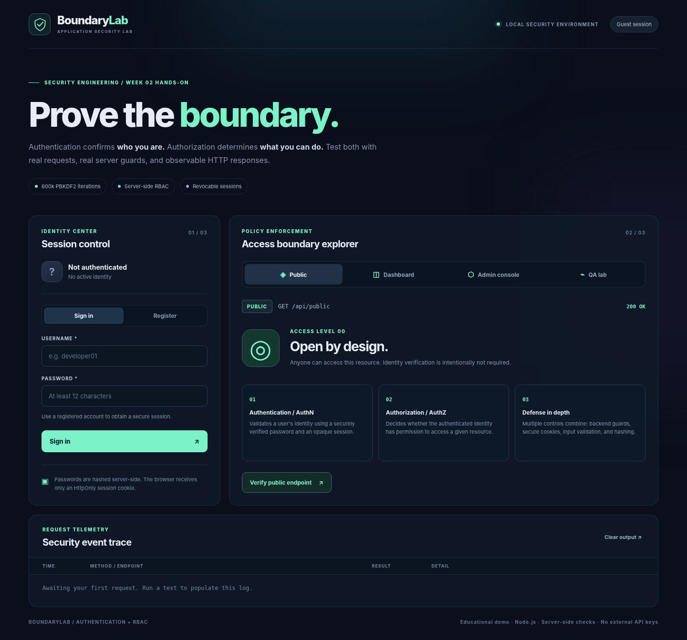
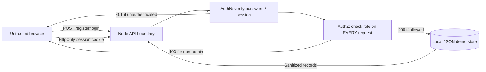

# BoundaryLab — Secure Authentication & Role-Based Access Control

 · Application Architecture / Security Engineering**

[](#quick-start) [](evidence/qa-results.json) [](#authorization-policy)

BoundaryLab is a lightweight, self-contained full-stack security demo. It provides **account registration, login, server-side session validation, a protected User dashboard, an Admin-only API, and an interactive QA console**. It is built with Node.js 22+, browser HTML/CSS/JavaScript, and built-in Node APIs. No external APIs, paid subscriptions, or dependency installation are necessary.

> **Scope:** This is a **local educational prototype**, not a production identity provider or a horizontally scalable authentication service. See [Security limitations](#security-limitations--production-migration) before deployment.

## Screenshot



*Image is a static Chromium render of the interface. The actual interactive server behavior is established through the automated integration tests. Live browser testing and DevTools capture should be performed by the presenter on their own machine.*

## Architecture



**Public routes** are intentionally unauthenticated. **Protected routes** require a valid server-side session. **Admin routes** additionally require `user.role === 'admin'` on the backend; showing or hiding a button in the browser is never treated as an access-control mechanism.

### Tech stack

| Layer | Implementation |
| --- | --- |
| Frontend | Vanilla HTML, CSS, JavaScript; `fetch()` with same-origin cookies |
| Backend | Node.js 22 built-in `node:http` REST API |
| Password storage | PBKDF2-HMAC-SHA-256, 600,000 iterations, unique random salt per user |
| Authentication | Opaque, 256-bit random session IDs; HttpOnly, SameSite=Strict cookies |
| Session persistence | SHA-256 hashes of high-entropy session tokens in a local JSON file |
| Authorization | Explicit server-side User/Admin route guards with 401/403 responses |
| QA | Built-in `node:test` integration tests and live UI probes |

### Authorization policy

| Resource | Guest | User | Admin |
| --- | :---: | :---: | :---: |
| `GET /api/public` | 200 | 200 | 200 |
| `GET /api/me` | **401** | 200 | 200 |
| `GET /api/user/dashboard` | **401** | 200 | 200 |
| `GET /api/admin/users` | **401** | **403** | 200 |

`401` means *there is no valid authenticated session*. `403` means *a known authenticated user lacks sufficient permissions*.

## Quick start

### Prerequisite

Install **Node.js 22 or newer**. Verify:

```bash
node --version
npm --version
```

### 1. Set local configuration

```bash
cp .env.example .env
```

On Windows PowerShell, use:

```powershell
Copy-Item .env.example .env
```

Edit `.env`, replacing the sample admin password with a **unique password of at least 12 characters**.

```dotenv
PORT=3000
DATA_FILE=.data/boundarylab.json
NODE_ENV=development
ADMIN_USERNAME=security_admin
ADMIN_PASSWORD=YOUR_OWN_STRONG_PRIVATE_DEMO_PASSWORD
```

**Never commit `.env`, user data, or real credentials.** The `.gitignore` excludes `.env` and `.data/`.

### 2. Create an Admin identity from the local CLI

```bash
npm run seed:admin
```

This intentionally requires local server/CLI access. Public registration always assigns the `user` role and cannot create administrators. If you need to recreate demo accounts, stop the server and remove `.data/boundarylab.json` (this deletes all local demo users and sessions), then seed again.

### 3. Launch the app

```bash
npm start
```

Open **http://localhost:3000**.

- Choose **Register** to create a normal User (password >= 12 characters).
- Sign in with the User credentials.
- Open **Dashboard**: 200, then **Admin console**: 403.
- Sign out, then sign in with the Admin credentials from `.env`.
- Open **Admin console**: 200 with a sanitized account table.
- Open **QA lab** to send and inspect security probes.

You do not need to install dependencies with `npm install`; this project has no third-party package dependencies.

### 4. Run the automated security QA suite

Open another terminal in the project root:

```bash
npm test
```

This runs 14 isolated integration tests and exports the actual result into:

- `evidence/qa-results.json`
- `evidence/qa-results.txt`

The tests use temporary local databases, so they do not change your demo accounts.

### 5. Inspect stored password hashes (recording evidence)

```bash
npm run inspect:hashes
```

You will see rows such as `algorithm=pbkdf2_sha256; iterations=600000; salt=...; hash=...` rather than plaintext passwords. The underlying local file is `.data/boundarylab.json`; do not show the full file publicly if it contains real user information.

## API specification

| Method | Endpoint | Result / security boundary |
| --- | --- | --- |
| `GET` | `/api/public` | Public, 200 |
| `POST` | `/api/register` | Validates username/password; always creates User, 201 |
| `POST` | `/api/login` | Verifies salted slow hash; starts server-backed session, 200; invalid credentials, 401 |
| `POST` | `/api/logout` | Revokes server-side session and deletes cookie, 204 |
| `GET` | `/api/me` | Current sanitized identity or 401 |
| `GET` | `/api/user/dashboard` | Any authenticated role or 401 |
| `GET` | `/api/admin/users` | Admin only; guest 401, regular user 403, Admin 200 |
| `GET` | `/health` | Health check, 200 |

All POST requests require JSON. Browser Origin headers are checked and the application does not enable cross-origin credentials. The frontend sends credentials via an HttpOnly session cookie (not a JWT in localStorage).

### Password and session mechanics

1. **Registration:** generate a fresh 128-bit salt; derive `PBKDF2-HMAC-SHA-256(password, salt, 600000, 32 bytes)`; save only the algorithm, iterations, salt, and derived bytes.
2. **Login:** derive a candidate hash from the supplied password; compare using constant-time equality; return the same generic error for unknown usernames or bad passwords. This does **not** make all forms of username enumeration impossible (for instance, registration conflict behavior is observable).
3. **Session creation:** generate a new random 256-bit token, store only its SHA-256 hash and expiration timestamp, and send the raw token in an HttpOnly, SameSite=Strict cookie. Production mode adds Secure and the `__Host-` cookie prefix.
4. **Session validation:** on every protected API call, hash the supplied cookie, look up the server session, check expiry, then read the user's **current role from storage**.
5. **Logout:** revoke the session in server storage. Replaying an old cookie produces 401 even if the browser cookie was copied beforehand.

## AI security audit & prompt log

**AI tool:** OpenAI ChatGPT (used for initial scaffolding and a security-focused review). The original assignment prompt is included **verbatim** in [`AI_PROMPTS_AND_AUDIT.md`](AI_PROMPTS_AND_AUDIT.md), alongside an AI first-pass authorization snippet that was reviewed and rejected and the corrected backend control. The audit documents both correct elements and required changes; it does not claim unperformed manual edits.

**Specific finding:** the first-pass pattern trusted a browser-side role check and would not protect the API if a user sent a direct request. This pattern was rejected. The delivered code checks session identity and role **in `src/app.js` on every `/api/admin/users` request** and returns 403 to any non-Admin session.

Additional protections include blocking `role` in registration input, secure password hashing, generic login errors, token revocation, and response sanitization.

## QA test summary

**Automated execution: 14 / 14 tests passed; 0 failed.** See [`evidence/qa-results.json`](evidence/qa-results.json) for machine-generated evidence.

| ID | Verified scenario | Automated result |
| --- | --- | --- |
| 01 | Public endpoint returns 200 | PASS |
| 02 | Guest access to protected/admin routes returns 401 | PASS |
| 03 | New User registration; no plaintext password in stored JSON | PASS |
| 04 | Unique random salts for the same password | PASS |
| 05 | Authenticated User gets dashboard 200 and admin 403 | PASS |
| 06 | Server-provisioned Admin accesses both User and Admin routes | PASS |
| 07 | Logout invalidates old session on server | PASS |
| 08 | Unknown user and wrong password share generic 401 message | PASS |
| 09 | Empty input, SQL-like username and role escalation rejected | PASS |
| 10 | SQL-like password input cannot bypass login | PASS |
| 11 | Cross-origin POST and non-JSON POST rejected | PASS |
| 12 | Malformed JSON and oversized request rejected | PASS |
| 13 | Excessive failed logins return 429 | PASS |
| 14 | Production cookie includes Secure and `__Host-` | PASS |

**Still required in the recorded demo:** open the app in your own browser, use DevTools Network to show 200/401/403, and confirm no uncaught JavaScript exceptions in Console. These are **manual video tasks**, not automatically verified by the Node test suite. Use [`QA_CHECKLIST.md`](QA_CHECKLIST.md) for the full original checklist.

## Files

```text
BoundaryLab/
├── public/
│   ├── index.html                # User/Admin/QA interface
│   ├── styles.css                # Original visual design
│   └── app.js                    # Same-origin browser API calls
├── src/
│   ├── app.js                    # HTTP endpoints and RBAC guards
│   ├── auth.js                   # PBKDF2 and secure session utilities
│   ├── store.js                  # Local persistent demo store
│   ├── server.js                 # Local server entry point
│   ├── seed-admin.js             # Admin-only local provisioning
│   └── inspect-hashes.js         # Hash inspection without leaking raw hash
├── test/auth.test.js            # 14 integration tests
├── scripts/run-qa.mjs           # QA evidence exporter
├── docs/architecture.mmd        # Self-authored Mermaid diagram
├── evidence/                    # Generated QA logs + interface preview
├── AI_PROMPTS_AND_AUDIT.md      # AI disclosure and security corrections
├── QA_CHECKLIST.md              # Grading checklist and evidence plan
├── VIDEO_SCRIPT.md              # 5–7 minute narration & screen actions
├── SUBMISSION_TEMPLATE.md       # Canvas submission text
├── .env.example                 # No secrets included
└── package.json
```

## Security limitations & production migration

This is deliberately a **single-process, local-only lab**. The JSON file is not a database suitable for concurrent instances, audit retention, backups, or untrusted hosting. The in-memory login rate limiter also does not share state across instances; the origin check relies on the local Host header. For production, use a transactional database with safe parameterized queries, a shared session store, distributed rate limiting, robust proxy/host validation, TLS, centralized audit logging, CSRF tokens as appropriate, operational monitoring, and a reviewed account recovery and MFA workflow. Never deploy this lab unchanged as a real authentication service or on stateless serverless hosting.

## Reference standards

- OWASP: [Password Storage Cheat Sheet](https://cheatsheetseries.owasp.org/cheatsheets/Password_Storage_Cheat_Sheet.html)
- OWASP: [Session Management Cheat Sheet](https://cheatsheetseries.owasp.org/cheatsheets/Session_Management_Cheat_Sheet.html)
- OWASP: [Authorization Cheat Sheet](https://cheatsheetseries.owasp.org/cheatsheets/Authorization_Cheat_Sheet.html)

